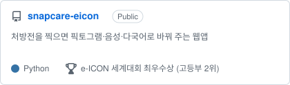
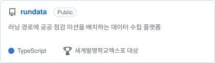

## 남윤수

충남삼성고등학교 11기 IT 디플로마

기존 기술이 실패하는 사람에서 문제를 찾고, AI 모델과 3D·시뮬레이션을 엮어 실제로 쓰이는 웹 서비스로 만듭니다.

연락처: [namyunsu1001@naver.com](mailto:namyunsu1001@naver.com)

### 활동

- **2025년 ~ 2026년** · 반도체·전기전자 동아리 **NanoX** 부기장
- **2025년** · AI연구팀 **CNSAi** 팀장

### 대표 프로젝트

<a href="https://github.com/n1a2m3y4u5n/liplab"><picture><source media="(prefers-color-scheme: dark)" srcset="assets/pin-liplab-dark.svg"></picture></a>
<a href="https://github.com/n1a2m3y4u5n/snapcare"><picture><source media="(prefers-color-scheme: dark)" srcset="assets/pin-snapcare-dark.svg"></picture></a>
<a href="https://github.com/n1a2m3y4u5n/rundata"><picture><source media="(prefers-color-scheme: dark)" srcset="assets/pin-rundata-dark.svg"></picture></a>
<a href="https://github.com/n1a2m3y4u5n/meonbada-titan-sim"><picture><source media="(prefers-color-scheme: dark)" srcset="assets/pin-meonbada-dark.svg"></picture></a>
<a href="https://github.com/n1a2m3y4u5n/reloop"><picture><source media="(prefers-color-scheme: dark)" srcset="assets/pin-reloop-dark.svg"></picture></a>
<a href="https://github.com/n1a2m3y4u5n/piezo-crowd-sensing"><picture><source media="(prefers-color-scheme: dark)" srcset="assets/pin-piezo-dark.svg"></picture></a>

### 수상 20

| 날짜 | 등급 | 명의 | 대회 | 작품 |
|---|---|---|---|---|
| 2026.09.18 | 동상 | 국가데이터처장상 | 제28회 전국학생통계활용대회 | 건강정보 AI 생성 실태 분석 |
| 2026.09.05 | 우수상 | (사)환경교육센터 이사장상 | 제15회 에너지·환경 탐구대회 | 산불 진압 하이드로겔 |
| 2026.08.31 | **최우수상** | 충남삼성고등학교장상 | 충남삼성고 11기 IT 디플로마 | |
| 2026.08.29 | 금상 | 지식재산처장상 | 제17회 전국 창의적 문제해결능력 경진대회 | |
| 2026.08.26 | **최우수상** | 지식재산처장상 | 제19회 전국학생창업발명경진대회 환경부 | LifeDoor |
| 2026.08.26 | 우수상 | 한국지식재산보호원장상 | 제19회 전국학생창업발명경진대회 창업부 | Reloop |
| 2026.08.14 | **대상** | KT 지니뮤직 사장상 (AX 뮤즈상) | 2026 K-AI 콘텐츠 공모전 Track B | [LIPLAB](https://github.com/n1a2m3y4u5n/liplab) |
| 2026.08.08 | **대상** | 한국교원단체총연합회장상 | 제2회 세계발명학교엑스포 발명 아이디어·시제품 부문 | [RunData](https://github.com/n1a2m3y4u5n/rundata) |
| 2026.08.08 | **대상** | 한국교원단체총연합회장상 | 제2회 세계발명학교엑스포 AI시대 문제해결 챌린지 부문 | 비탑승 주행거리 과금 |
| 2026.08.07 | **최우수상** (고등부 2위) | 한국디지털교육협회장상 | 제16회 e-ICON 세계대회 | [SnapCare](https://github.com/n1a2m3y4u5n/snapcare) |
| 2026.07.21 | 선발 | 한국언론인협회장 · 국회 디지털경제3.0포럼 대표의원 | 제11회 4차 산업혁명 AI 영재장학생 | |
| 2026.04.22 | 은상 (2위) | 충남삼성고등학교장상 | 교내 청소년 과학 페어 | 해양 쓰레기 수거선 경로탐색 |
| 2026.04.18 | 장려상 | 행복일자리운동본부 이사장상 | 제4회 IT코딩 발명 아이디어 및 에세이 경진대회 | [LIPLAB](https://github.com/n1a2m3y4u5n/liplab) |
| 2026.02.26 | 동상 | 매경미디어 회장상 | 제5회 MBN 원더차일드 창의발명대회 | [압전 군중 밀집도 감지](https://github.com/n1a2m3y4u5n/piezo-crowd-sensing) |
| 2025.12.31 | 장려상 | 충청남도교육감상 | 제6회 AI·SW 학생 동아리 한마당 | CNSAi |
| 2025.11.08 | 우수상 | 선박해양플랜트연구소장상 | 제6회 미래바다 아이디어 공모전 | [먼바다호](https://github.com/n1a2m3y4u5n/meonbada-titan-sim) |
| 2025.10.25 | 입상 | (사)나눔과기술 대표상 | 제17회 소외된 이웃과 함께하는 창의설계 경진대회 | InsuNest |
| 2025.10.15 | 금상 (1위) | 충남삼성고등학교장상 | 교내 과학발명품 경진대회 | LifeDoor |
| 2025.08.01 | 우수상 | UNIST 총장상 | 제9회 슈퍼컴퓨팅 청소년캠프 | MPI 감염병 확산 시뮬레이터 |
| 2025.04.15 | 은상 (2위) | 충남삼성고등학교장상 | 교내 청소년 과학 페어 | [Reloop](https://github.com/n1a2m3y4u5n/reloop) |

### 그 밖의 작업

- **시뮬레이션·시각화**: [해양 쓰레기 수거선 경로](https://ocean-cleanup-sim.fly.dev) · [두 도선의 자기력선](https://namyunsu-bfield.fly.dev) · [GJK 충돌 판정](https://github.com/n1a2m3y4u5n/gjk-analyzer) · [LOD Playground](https://github.com/n1a2m3y4u5n/lod-playground) · [독도 시뮬레이터](https://github.com/n1a2m3y4u5n/dokdo-simulator)
- **AI·데이터 연구**: [마이크로플라스틱 검출](https://microplastic-detection.fly.dev) · [건강정보 AI 오염 실태 크롤러](https://github.com/n1a2m3y4u5n/health-ai-pollution-crawler) · [스택 버퍼 오버플로우 탐지](https://github.com/n1a2m3y4u5n/bof-scfg) · [행렬 게임 AI](https://matrix-game-nys.fly.dev)
- **교육용 서비스**: [IlliHealth](https://illihealth-web.fly.dev) · [EduShield](https://github.com/n1a2m3y4u5n/edushield)
- **하드웨어**: [바이오 하이드로겔 산불 진압 발사 장치](https://github.com/n1a2m3y4u5n/hydrogel-launcher) · [아두이노 CT 스캐너](https://github.com/n1a2m3y4u5n/ct-scanner)

### 기술

`Python` `PyTorch` `wav2vec2·WavLM` `MediaPipe` `ONNX Runtime Web` `React` `TypeScript` `Next.js` `three.js` `FastAPI` `Arduino` `MPI`
