 

&nbsp;
&nbsp;
&nbsp;

카드를 누르면 데모(LIVE) 또는 저장소로 이동합니다 · 코드: [LIPLAB](https://github.com/n1a2m3y4u5n/liplab) · [SnapCare](https://github.com/n1a2m3y4u5n/snapcare-eicon) · [RunData](https://github.com/n1a2m3y4u5n/rundata) · [먼바다호](https://github.com/n1a2m3y4u5n/meonbada-titan-sim) · [Reloop](https://github.com/n1a2m3y4u5n/reloop-app) · [압전](https://github.com/n1a2m3y4u5n/piezo-sim)

  

 

### 그 밖의 작업

- **시뮬레이션·시각화**: [해양 쓰레기 수거선 경로](https://ocean-cleanup-sim.fly.dev) · [두 도선의 자기력선](https://namyunsu-bfield.fly.dev) · [GJK 충돌 판정](https://github.com/n1a2m3y4u5n/gjk-analyzer) · [LOD Playground](https://github.com/n1a2m3y4u5n/lod-playground) · [독도 시뮬레이터](https://github.com/n1a2m3y4u5n/dokdo-simulator)
- **AI·데이터 연구**: [마이크로플라스틱 검출](https://microplastic-detection.fly.dev) · [건강정보 AI 오염 실태 크롤러](https://github.com/n1a2m3y4u5n/health-ai-pollution-crawler) · [스택 버퍼 오버플로우 탐지(BOF-SCFG)](https://github.com/n1a2m3y4u5n/bof-scfg) · [행렬 게임 AI](https://matrix-game-nys.fly.dev)
- **교육용 서비스**: [피싱 인식 훈련](https://phishing-edu-demo.fly.dev) · [IlliHealth](https://illihealth-web.fly.dev) · [EduShield](https://github.com/n1a2m3y4u5n/edushield)
- **하드웨어**: [바이오 하이드로겔 산불 진압 발사 장치](https://github.com/n1a2m3y4u5n/hydrogel-launcher) · [아두이노 CT 스캐너](https://github.com/n1a2m3y4u5n/ct-scanner)
- **팀 협업 도구**: [CPS 본선 현장 운영 환경](https://github.com/n1a2m3y4u5n/cps-bonseon)

### 다루는 기술

음성(wav2vec2·WavLM, CTC) · 비전(MediaPipe, 입술 판독) · ONNX 브라우저 추론 · 강화학습 · CFD · MPI 병렬 계산 · Fly.io 배포
